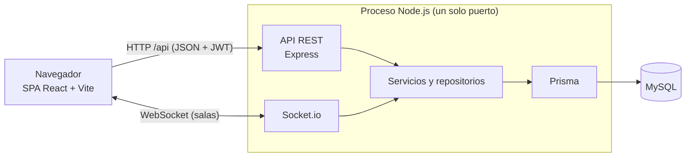

# MindGame

MindGame es un videojuego educativo e interactivo, desarrollado como aplicación web responsive, que busca reforzar el aprendizaje mediante misiones de contenido histórico y de convivencia, retos con retroalimentación, puntos, niveles, recompensas y logros. Está dirigido a estudiantes de colegio, con un rol docente que gestiona grupos, consulta estadísticas y dirige actividades grupales en tiempo real, y un rol administrador que gestiona el contenido. El contenido de demostración incluye historia de Colombia (Los Muiscas, el Movimiento Comunero, la Constitución de 1991) y convivencia escolar.

Este archivo es el punto de entrada del repositorio. El detalle técnico vive en [`backend/README.md`](backend/README.md), en [`frontend/README.md`](frontend/README.md) y en [`docs/`](docs).

## Estado del proyecto

MVP en desarrollo. El periodo del proyecto es de agosto a octubre de 2026 (ver [`docs/PlanDeTrabajo.md`](docs/PlanDeTrabajo.md)).

**Implementado:**

- Cuentas (registro, inicio y cierre de sesión, recuperación de contraseña) y perfil.
- Misiones con historias, retos (cuatro tipos, con evaluación automática) y actividades.
- Puntos, niveles, recompensas y logros; mensajes positivos y misiones de convivencia.
- Panel de administración del contenido.
- Docente: grupos con código de ingreso y estadísticas de grupo y de estudiante.
- Actividades grupales en tiempo real (salas con Socket.io).
- Refuerzo de seguridad (JWT, roles, CORS, cabeceras, límites de intentos), integración continua y datos de demostración.

**Pendiente** (Sprint 5 de integración, seguridad y pulido, según el plan y [`docs/GUIA_DEMO.md`](docs/GUIA_DEMO.md)):

- Aviso de privacidad y mecanismo de autorización de datos de menores (Ley 1581 de 2012).
- Pruebas automatizadas de extremo a extremo.
- Auditoría de responsive y accesibilidad.
- Entorno desplegado con HTTPS/WSS: el código ya lo soporta, pero no está desplegado.
- Definir y medir el umbral de latencia de las actividades en tiempo real (RNF-013).
- Pantalla de inicio del estudiante (hoy es un marcador de posición) y menús aún deshabilitados (Retos, Convivencia y Usuarios).

## Roles y funcionalidades

| Rol           | Qué puede hacer                                                                                                                                                                                              |
| ------------- | ------------------------------------------------------------------------------------------------------------------------------------------------------------------------------------------------------------ |
| Estudiante    | Explorar misiones históricas y de convivencia; leer historias, responder retos y completar actividades; ver puntos, nivel, recompensas y logros; unirse a grupos con un código; participar en salas en vivo. |
| Docente       | Crear grupos (el sistema genera el código); ver y retirar estudiantes; consultar estadísticas del grupo y de cada estudiante; abrir y dirigir actividades grupales en tiempo real.                           |
| Administrador | Ver el resumen del contenido y gestionar (crear, editar, activar o desactivar y eliminar) misiones, historias, retos, actividades, recompensas, logros y mensajes positivos.                                 |

Todos los roles pueden editar su perfil. El registro público admite estudiantes y docentes (este último con un código que define el servidor); el administrador se crea con un seeder. El mapa de rutas está en [`frontend/README.md`](frontend/README.md#4-mapa-de-rutas-por-rol) y el de endpoints en [`backend/README.md`](backend/README.md#8-api-rest).

## Arquitectura



El cliente es una SPA de React que consume la API REST con `axios` y abre un socket solo para las salas en vivo. El backend atiende ambos canales en el mismo proceso y puerto, y separa el código en rutas, controladores, servicios (reglas de negocio) y repositorios (único punto de acceso a Prisma). La evaluación de retos usa el patrón Strategy, y el esquema se gestiona con migraciones SQL propias. Las capas se describen en [`backend/README.md`](backend/README.md#6-arquitectura-y-estructura-de-carpetas) y el diseño completo, en [`docs/SDD.md`](docs/SDD.md).

| Componente     | Tecnología                               | Versión (`package.json`)            |
| -------------- | ---------------------------------------- | ----------------------------------- |
| Runtime        | Node.js                                  | 24 (CI; sin `engines`)              |
| Frontend       | React, Vite y `react-router-dom`         | `^19.2.8`, `^8.2.2` y `^7.18.3`     |
| Cliente HTTP   | `axios` y `socket.io-client`             | `^1.20.0` y `^4.8.3`                |
| Servidor       | Express y Socket.io                      | `^5.2.1` y `^4.8.3`                 |
| Acceso a datos | Prisma ORM con `@prisma/adapter-mariadb` | `^7.10.0`                           |
| Base de datos  | MySQL                                    | versión no fijada en el repositorio |
| Autenticación  | `jsonwebtoken` (HS256) y `bcrypt`        | `^9.0.3` y `^6.0.0`                 |
| Calidad        | ESLint 10 y Prettier 3                   | ver `package.json` de cada paquete  |

## Estructura del repositorio

```text
.
├── backend/              API REST + Socket.io, migraciones, seeders y esquema de Prisma
├── frontend/             cliente web (React + Vite)
├── docs/                 ERS, SDD, plan de trabajo, guía de demostración y mapas de pantallas
├── .github/workflows/    integración continua (ci.yml)
├── .prettierrc.json      configuración de formato compartida
└── .prettierignore
```

| Carpeta     | Documentación                                       |
| ----------- | --------------------------------------------------- |
| `backend/`  | [`backend/README.md`](backend/README.md)            |
| `frontend/` | [`frontend/README.md`](frontend/README.md)          |
| `docs/`     | tabla de la sección [Documentación](#documentación) |

## Inicio rápido

Prerrequisitos: Node.js 24, npm y un servidor MySQL en ejecución. Cada paso enlaza con el detalle del README correspondiente.

**Backend** (desde `backend/`; la referencia completa está en [Puesta en marcha](backend/README.md#3-puesta-en-marcha)):

```bash
npm ci
cp .env.example .env     # completar DB_*, JWT_SECRET, ADMIN_* y DOCENTE_REGISTRATION_CODE
# crear la base de datos vacía (CREATE DATABASE, con el nombre de DB_NAME)
npm run db:migrate
npx prisma generate --config prisma7.config.ts
npm run db:seed
npm run db:seed:demo     # opcional: datos de demostración
npm run dev              # http://localhost:3000
```

Las variables del `.env` se explican en [Variables de entorno](backend/README.md#4-variables-de-entorno). Para registrar docentes hace falta definir `DOCENTE_REGISTRATION_CODE`; sin él, ese registro responde 403.

**Frontend** (otra terminal, desde `frontend/`; ver [Puesta en marcha](frontend/README.md#2-puesta-en-marcha)):

```bash
npm ci
npm run dev              # http://localhost:5173
```

Abra la aplicación en `http://localhost:5173`: es el único origen que el CORS del backend acepta por defecto (junto con `http://127.0.0.1:5173`). Si Vite abre otro puerto, verá errores 403 de CORS; use `npm run dev -- --strictPort` o agregue el origen a `CORS_ORIGINS`. El frontend no necesita `.env` si el backend corre en `http://localhost:3000`.

## Datos de demostración

`npm run db:seed:demo` (en `backend/`) carga docentes, estudiantes, misiones, grupos y progreso de ejemplo; es idempotente y se niega a correr con `NODE_ENV=production`. Para borrar solo lo que creó y volver a cargarlo:

```bash
npm run db:seed:demo:reset
npm run db:seed:demo
```

Las cuentas, los códigos de grupo, el guion de presentación de 15 minutos y las limitaciones conocidas están en [`docs/GUIA_DEMO.md`](docs/GUIA_DEMO.md). No se repiten aquí.

## Documentación

| Documento                                                                                                                                                                                                                 | Contenido                                                          |
| ------------------------------------------------------------------------------------------------------------------------------------------------------------------------------------------------------------------------- | ------------------------------------------------------------------ |
| [`docs/ERS.md`](docs/ERS.md) ([`.docx`](docs/MindGame_ERS_v1.2.docx))                                                                                                                                                     | Especificación de requisitos (RF y RNF), versión 1.2               |
| [`docs/SDD.md`](docs/SDD.md) ([`.docx`](docs/MindGame_SDD_v1.0.docx))                                                                                                                                                     | Diseño del software: arquitectura, datos, API y seguridad          |
| [`docs/PlanDeTrabajo.md`](docs/PlanDeTrabajo.md) ([`.docx`](docs/MindGame_PlanDeTrabajo_v1.0.docx))                                                                                                                       | Equipo, sprints, hitos y riesgos                                   |
| [`docs/GUIA_DEMO.md`](docs/GUIA_DEMO.md)                                                                                                                                                                                  | Arranque para demostraciones, cuentas, guion y limitaciones        |
| Mapas de pantalla: [estudiante](docs/Mapa_de_pantalla_usuario_estudiante_mindgame.png), [docente](docs/Mapa_de_pantalla_usuario_docente_mindgame.png) y [administrador](docs/Mapa_de_pantalla_usuario_admin_mindgame.png) | Flujo de pantallas por rol                                         |
| [`backend/README.md`](backend/README.md)                                                                                                                                                                                  | Puesta en marcha, variables, scripts, base de datos, API y sockets |
| [`frontend/README.md`](frontend/README.md)                                                                                                                                                                                | Puesta en marcha, estructura, rutas por rol y comunicación         |

## Flujo de trabajo del equipo

- **Ramas y pull requests.** Todo cambio llega a `main` mediante un pull request desde una rama con prefijo de tipo (`feat/`, `fix/`, `docs/`). No se hacen push directos a `main`.
- **Commits.** Conventional commits en español, por ejemplo `docs(demo): corrige cuándo se envía el correo de recuperación`.
- **Integración continua.** [`.github/workflows/ci.yml`](.github/workflows/ci.yml) corre en cada pull request y en cada push a `main`, con Node 24.
  - Job `backend`: `npm ci`, `prisma validate`, `prisma generate`, `node --check` sobre `src` y `database`, ESLint, una prueba de arranque que importa `src/app.js` sin abrir el servidor ni la base de datos y `npm run routes:audit`.
  - Job `frontend`: `npm ci` y `npm run lint`. No ejecuta `npm run build` ni pruebas.
- **Fusión.** Se fusiona con merge commit, como en el historial actual. Se recomienda activar la protección de la rama `main` (exigir pull request y los jobs de CI en verde); requiere permisos de administrador del repositorio.
- **Pull requests apilados.** Si un PR depende de otro, cambie la base del PR hijo a `main` antes de fusionarlo, o fusione un único PR de integración.
- **Formato.** `npm run lint` y `npm run format:check` en cada paquete antes de abrir el PR; la configuración de Prettier es única y está en la raíz.
- **Buenas prácticas aprendidas.** La CI existe para evitar que vuelva a romperse `main` (por ejemplo, un `schema.prisma` inválido tras un merge o un `export default` duplicado). No hay todavía pruebas automatizadas: toda funcionalidad nueva debe recorrerse a mano con los datos de demostración.

## Seguridad y datos personales

La API autentica con JWT (HS256, con emisor, audiencia y vigencia), valida la sesión contra la base de datos en cada petición, restringe cada ruta por rol, limita los intentos de autenticación y acota los orígenes permitidos (CORS). El sistema trata datos personales de menores de edad, por lo que debe cumplir la Ley 1581 de 2012 (RNF-014): hoy el registro solo incluye una casilla de aceptación del tratamiento de datos, y el aviso de privacidad y el mecanismo formal de autorización siguen pendientes. Las medidas implementadas, la configuración mínima para producción y la auditoría de rutas están en [`backend/README.md`](backend/README.md#10-seguridad). Los archivos `.env` no se versionan; nunca suba secretos al repositorio.

## Equipo y licencia

Según el [plan de trabajo](docs/PlanDeTrabajo.md), el equipo es de cinco personas: Scrum Master y Tech Lead, desarrollador backend (que también asume las tareas de DevOps), dos desarrolladores frontend y diseñador UX y QA. El repositorio no lista nombres.

El repositorio no incluye un archivo `LICENSE`: no tiene licencia definida. El `package.json` del backend declara `ISC`, pero eso no sustituye una licencia para el proyecto.

## Solución de problemas rápida

| Síntoma                                                   | Qué revisar                                                                                                                                                                       |
| --------------------------------------------------------- | --------------------------------------------------------------------------------------------------------------------------------------------------------------------------------- |
| 403 o error de CORS en el navegador                       | El frontend no está en `http://localhost:5173`. Ver [CORS en el backend](backend/README.md#12-solución-de-problemas) y el [frontend](frontend/README.md#9-solución-de-problemas). |
| `Cannot find module '.../generated/prisma/client.ts'`     | Falta `npx prisma generate --config prisma7.config.ts` (se repite tras cada cambio de `prisma/schema.prisma`).                                                                    |
| `Faltan variables de entorno requeridas` o `ECONNREFUSED` | Revise `backend/.env` y que MySQL esté activo y la base de datos creada. Ver [Variables de entorno](backend/README.md#4-variables-de-entorno).                                    |
| Registrar un docente responde 403                         | Falta `DOCENTE_REGISTRATION_CODE` en el servidor o el código ingresado no coincide.                                                                                               |
| "Demasiados intentos" (429) durante una demostración      | Límite de intentos de autenticación; reinicie el backend o use `RATE_LIMIT_DISABLED=true` en `.env`.                                                                              |
| Vuelve al inicio de sesión tras cambiar la configuración  | Cambiar `JWT_SECRET`, `JWT_ISSUER` o `JWT_AUDIENCE` invalida los tokens: cierre sesión y vuelva a ingresar.                                                                       |

La lista completa está en [Solución de problemas del backend](backend/README.md#12-solución-de-problemas) y [del frontend](frontend/README.md#9-solución-de-problemas).
